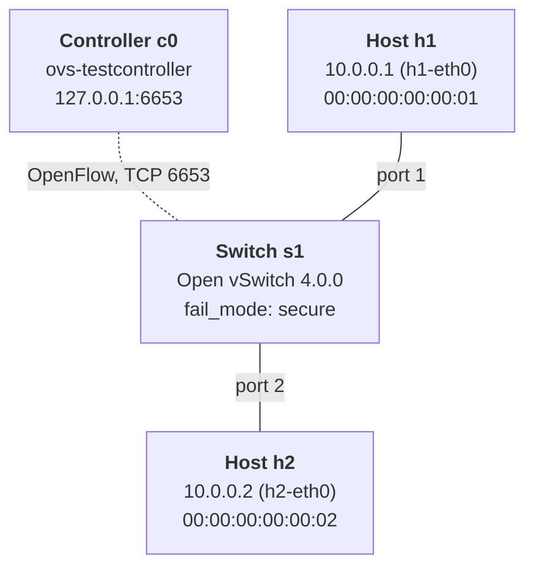

# Basic SDN Environment with Mininet and Open vSwitch

A hands-on personal project in which I built and tested a small Software-Defined Network (SDN) on Kali Linux: one OpenFlow switch, two hosts and a controller. I used Mininet and Open vSwitch, confirmed the hosts could communicate with 0% packet loss, and read the flow rules the controller installed in the switch.

**Author:** ITA ARTHUR OLUWAPELMI · **Date:** November 2026


---

## Contents

- [Environment](#environment)
- [Background](#background)
- [Network topology](#network-topology)
- [Procedure and results](#procedure-and-results)
- [Flow table analysis](#flow-table-analysis)
- [Deviations and troubleshooting](#deviations-and-troubleshooting)
- [Reflection](#reflection)
- [Skills demonstrated](#skills-demonstrated)
- [Next steps](#next-steps)

---

## Environment

| Item | Details |
| --- | --- |
| Host setup | Kali Linux VM in Oracle VirtualBox on a Windows PC |
| Network emulator | Mininet 2.3.0 |
| Software switch | Open vSwitch 4.0.0 (DB schema 8.8.0) |
| Controller | `ovs-testcontroller` (Mininet's default controller) |

**Objectives**

1. Explain the difference between the control plane and the data plane.
2. Install Mininet and Open vSwitch.
3. Build a minimal topology and explore it with the Mininet CLI.
4. Verify host-to-host connectivity with ping.
5. Read the OpenFlow flow table on the virtual switch.

---

## Background

SDN separates the part of a network that decides where traffic goes from the part that forwards it, so the whole network can be managed from one central program.

| Term | What it is | In this project |
| --- | --- | --- |
| Control plane | The "brain" that decides how traffic should be forwarded | Controller **c0** (ovs-testcontroller) |
| Data plane | The hardware or software that forwards packets according to rules | Switch **s1** (Open vSwitch) |
| OpenFlow | The protocol the controller uses to install rules in the switch | TCP port 6653 between c0 and s1 |
| Flow entry | One rule in the switch: a match (what the packet looks like) and an action (what to do) | Inspected with `dump-flows` |
| Mininet | Emulates a whole network of hosts, switches and links on one Linux machine | Created h1, h2, s1 and c0 |
| Open vSwitch (OVS) | A production-grade software switch that supports OpenFlow | The switch type behind s1 |

In a traditional network, every switch makes its own forwarding decisions and has to be configured one by one. In SDN, the switches only follow rules, and the controller writes those rules for all of them.

---

## Network topology

`sudo mn --topo minimal` creates the smallest possible SDN: two hosts on one OpenFlow switch, managed by one controller.



The solid lines are data links (h1 on switch port 1, h2 on port 2). The dashed line is the control channel: c0 never forwards host traffic itself, it only tells s1 what to do. The `--mac` option gives the hosts simple MAC addresses ending in 01 and 02.

---

## Procedure and results

### Part 1: Install Mininet and Open vSwitch

```bash
sudo apt update
sudo apt install -y mininet openvswitch-switch openvswitch-testcontroller net-tools git
sudo ovs-vsctl --version
sudo mn --version
```

The install completed without errors. Open vSwitch reported version 4.0.0 and Mininet reported 2.3.0.


*Figure 1: Open vSwitch 4.0.0 and Mininet 2.3.0 installed.*

### Part 2: Start Open vSwitch and launch the network

```bash
sudo systemctl start openvswitch-switch
sudo systemctl enable openvswitch-switch
sudo systemctl status openvswitch-switch
sudo mn -c
sudo mn --topo minimal --controller default --switch ovs --mac
```

The OVS service showed `Active: active (exited)` with `status=0/SUCCESS`. On Kali this unit is a wrapper that starts the real OVS daemons and then exits, so "exited" is the healthy state. Mininet then created controller c0, hosts h1 and h2, switch s1 and the two links, and opened the `mininet>` prompt.


*Figure 2: Open vSwitch service enabled and active.*

### Part 3: Explore and test the network

```
mininet> nodes
mininet> links
mininet> dump
mininet> h1 ifconfig
mininet> h2 ifconfig
mininet> h1 route
mininet> h1 ping -c 4 h2
mininet> h2 ping -c 4 h1
mininet> pingall
```

| Check | Result |
| --- | --- |
| `nodes` | c0 h1 h2 s1 |
| `links` | h1-eth0 to s1-eth1 (OK OK) and h2-eth0 to s1-eth2 (OK OK) |
| `dump` | h1 = 10.0.0.1, h2 = 10.0.0.2, controller c0 at 127.0.0.1:6653 |
| `h1 route` | 10.0.0.0/8 reached directly through h1-eth0, gateway 0.0.0.0 (no router needed) |
| `h1 ping -c 4 h2` | 4 sent, 4 received, 0% loss; avg 2.438 ms |
| `h2 ping -c 4 h1` | 4 sent, 4 received, 0% loss; avg 0.589 ms |
| `pingall` | 0% dropped (2/2 received) |


*Figure 3: Network launched; nodes, links and dump output.*


*Figure 4: Pings in both directions and pingall, all with 0% loss.*


*Figure 5: Routing table of h1.*

**Key observation:** from h1 to h2, packet 1 took **7.79 ms** but packet 4 took **0.054 ms**, about 140 times faster. The switch had no rule for the first packet, so it sent it to the controller. The controller installed a rule, and the later packets were forwarded by the switch alone. The same pattern appeared from h2 to h1 (1.95 ms, then 0.086 ms).

### Part 4: Inspect the switch

```bash
sudo ovs-ofctl dump-flows s1     # second terminal
mininet> pingall
mininet> dpctl dump-flows        # run immediately after pingall
sudo ovs-ofctl show s1
sudo ovs-vsctl show
```

The first `dump-flows`, run several minutes after the pings, showed only the default table-miss rule. Running `pingall` and then `dpctl dump-flows` straight away showed four new forwarding rules (analysed below).

`ovs-ofctl show s1` reported datapath ID `0000000000000001`, port 1 = s1-eth1 and port 2 = s1-eth2 (both 10 Gbps virtual copper), and the internal LOCAL port as down, which is expected because nothing uses it. `ovs-vsctl show` confirmed bridge s1 was connected to its controller at `tcp:127.0.0.1:6653` (`is_connected: true`).


*Figure 6: Flow table with no recent traffic: only the table-miss rule.*


*Figure 7: Flow table right after pingall: four ICMP forwarding rules.*


*Figure 8: Switch ports and capabilities (ovs-ofctl show s1).*


*Figure 9: OVS configuration (ovs-vsctl show).*

### Part 5: Clean up

```
mininet> exit
sudo mn -c
```

Mininet stopped the controller, links, switch and hosts. `mn -c` then removed leftover processes, interfaces and OVS datapaths and ended with `*** Cleanup complete.`


*Figure 10: Mininet cleanup complete.*

---

## Flow table analysis

After `pingall`, the controller had installed one rule for each direction of each ping conversation, four in total, on top of the default rule that sends unknown traffic to the controller.

| # | Arrives on | Source to destination | ICMP type | Action | Priority |
| --- | --- | --- | --- | --- | --- |
| 1 | s1-eth1 (from h1) | 10.0.0.1 to 10.0.0.2 | 8, echo request | output s1-eth2 (to h2) | 1 |
| 2 | s1-eth2 (from h2) | 10.0.0.2 to 10.0.0.1 | 0, echo reply | output s1-eth1 (to h1) | 1 |
| 3 | s1-eth2 (from h2) | 10.0.0.2 to 10.0.0.1 | 8, echo request | output s1-eth1 (to h1) | 1 |
| 4 | s1-eth1 (from h1) | 10.0.0.1 to 10.0.0.2 | 0, echo reply | output s1-eth2 (to h2) | 1 |
| 5 | any port | anything not matched above | any | send to CONTROLLER | 0 |

Rules 1 and 2 carry "h1 pings h2" and its reply; rules 3 and 4 carry "h2 pings h1" and its reply. Each rule also matched the MAC addresses (00:00:00:00:00:01 and :02) and the VLAN tag field.

What I learned from the details:

- **Rules are specific.** A simple example rule matches only the input port (`in_port=1 actions=output:2`). Kali's ovs-testcontroller writes much narrower rules that match port, MAC, IP and ICMP type. The idea is the same, but a new kind of traffic (for example HTTP between the same hosts) would go to the controller again.
- **Rules expire.** Every rule had `idle_timeout=60`, so it deleted itself after 60 seconds without matching traffic. That is why my first `dump-flows` showed only rule 5.
- **`n_packets=0` on new rules.** The packet that triggered each rule was handled by the controller, which installed the rule and sent that packet on itself. `pingall` sends only one ping per direction, so nothing else matched before I looked.
- **The table-miss rule counted 29, then 51 packets.** That counter grew with each test, showing how many first packets (and ARP requests) had to go to the controller for a decision.
- **`fail_mode: secure`.** It means s1 will not fall back to behaving like an ordinary learning switch if the controller disappears; it only follows rules it already has.

---

## Deviations and troubleshooting

The lab guide I followed was written for Ubuntu 20.04/22.04. I completed it on Kali Linux, which is Debian-based and uses the same apt and systemd tools.

| Guide says | What I did | Why |
| --- | --- | --- |
| Ubuntu 20.04 or 22.04 | Kali Linux VM in VirtualBox | Kali was already installed; it is Debian-based, so the packages are the same |
| Install Mininet with `git clone` and `util/install.sh -a` | `sudo apt install mininet` | The install script checks for Ubuntu/Debian/Fedora and often fails on Kali; Kali's repositories already ship Mininet 2.3.0 |
| `sudo apt upgrade -y` before starting | Skipped; ran `apt update` only | A full Kali upgrade can be several GB and is not needed here |
| Run `ovs-ofctl dump-flows s1` in a second terminal | Ran `dpctl dump-flows` inside Mininet, straight after `pingall` | Rules expire after 60 s; the delay in a second terminal meant they were gone |

| Problem | Cause | Fix |
| --- | --- | --- |
| `systemctl stop openvswitch-testcontroller` failed: unit not loaded | The test controller is not installed as a background service on Kali | None needed: it confirmed port 6653 was free for Mininet's controller |
| `zsh: bad pattern: ^[[200~sudo` | Pasting into the terminal added hidden bracketed-paste characters | Retyped the command |
| First `dump-flows` showed only the CONTROLLER rule | Flow rules had idle-timed out | Ran `pingall` then dumped the flows immediately |
| `Unknown command: dpct1 dump-flows` and `ovs-ofct1: not found` | Typed the digit 1 instead of the letter l (`dpctl`, `ovs-ofctl`) | Retyped with a lowercase L |

---

## Reflection

**1. What is the difference between the control plane and the data plane?**

The control plane decides where traffic should go; the data plane actually moves the packets. In SDN they run in different places: controller c0 made the decisions and switch s1 only carried them out. My ping times showed this split. The first packet from h1 to h2 took 7.79 ms because it went up to the controller for a decision; later packets took about 0.05 ms because the switch forwarded them using the rule it had been given.

**2. What role does the controller (c0) play, and what would happen if it were turned off?**

c0 is the brain of the network. Whenever s1 receives a packet that matches no rule, the table-miss rule sends it to c0, which decides where it should go and installs a flow rule so the switch can handle similar packets alone. If c0 were turned off, existing rules would keep working until they expired (60 seconds here). After that, new traffic would hit the table-miss rule with no controller to answer, and because the switch runs in `fail_mode: secure`, s1 would not fall back to normal switching. The hosts would stop communicating.

**3. What does `in_port=1, actions=output:2` mean in plain English?**

"Any packet that enters the switch on port 1, which connects to h1, should be sent out of port 2, towards h2." My rule 1 is the same instruction narrowed to ping requests from 10.0.0.1 to 10.0.0.2.

**4. Why run `pingall` before checking the flow table, and what would it look like with no traffic?**

The controller only creates rules when traffic needs them, and they expire after a period of inactivity. Without recent traffic, the table holds only the default `priority=0 actions=CONTROLLER` rule. I saw exactly this in Figure 6, a few minutes after my pings, and then four forwarding rules in Figure 7, seconds after `pingall`.

**5. Where would SDN be beneficial in the real world?**

- **Data centres and cloud providers:** thousands of virtual machines are created, moved and deleted every day. A controller can reprogram the network for them automatically instead of engineers reconfiguring switches one by one.
- **Security response in an enterprise or campus network:** when a device is found to be infected, one controller policy can isolate it on every switch at once. From a cybersecurity point of view, this is the use I find most relevant: centralised control makes quarantine and traffic monitoring fast and consistent.

---

## Skills demonstrated

- Linux package management and service control (apt, systemctl) on Kali
- Network emulation with Mininet; using its CLI to inspect hosts, links and routes
- Open vSwitch administration with `ovs-vsctl` and `ovs-ofctl`
- Reading and interpreting OpenFlow flow entries (match fields, actions, priority, idle timeout)
- Connectivity testing and reading latency results
- Troubleshooting: service errors, terminal paste issues, expired flows and command typos
- Documenting deviations from a lab guide

## Next steps

- Replace the test controller with a programmable one such as Ryu or POX, and write a simple forwarding app.
- Try a larger topology (for example `--topo tree,depth=2`) and add a rule by hand with `ovs-ofctl add-flow` to block traffic between two hosts.

## Conclusion

I built and tested a working SDN on Kali Linux and watched the controller program the switch in real time: a slow first packet, then fast switch-only forwarding, then rules that expired after 60 seconds. Adapting an Ubuntu guide to a different distribution, and fixing each error as it appeared, taught me as much as the lab steps themselves.
